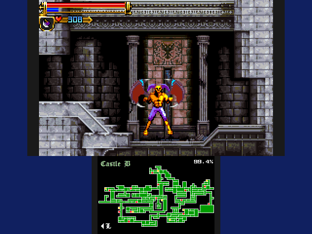
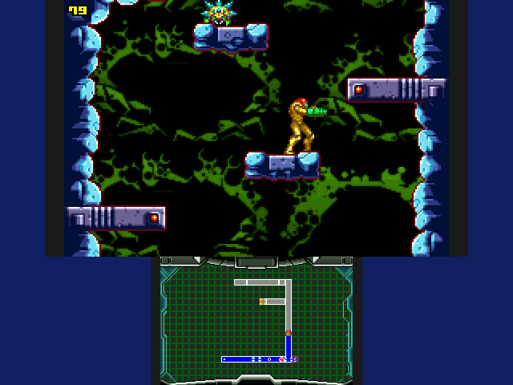
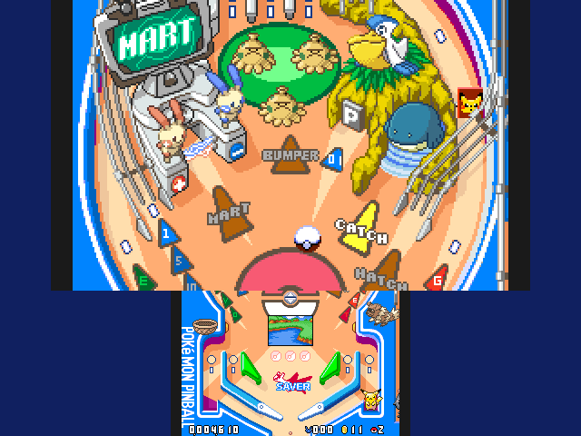
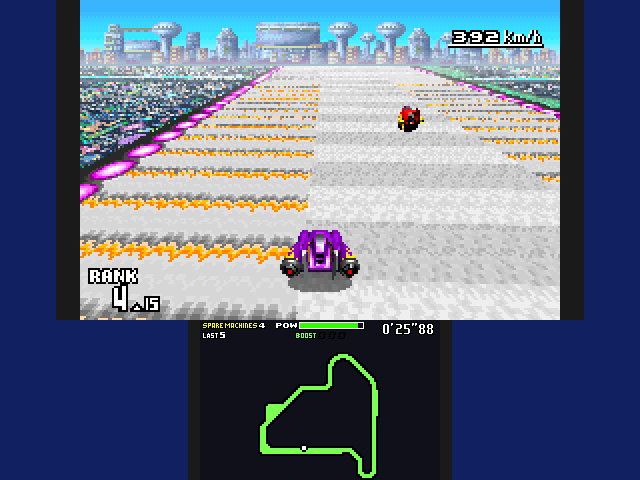
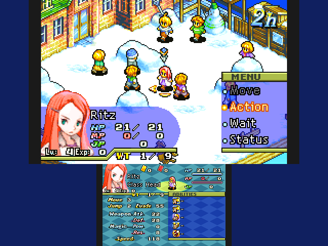
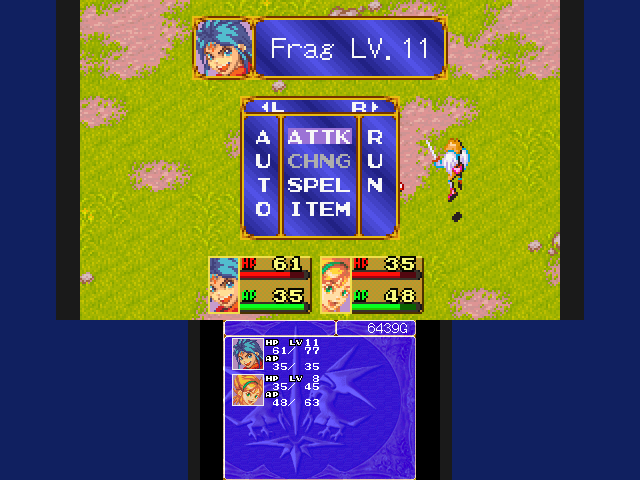
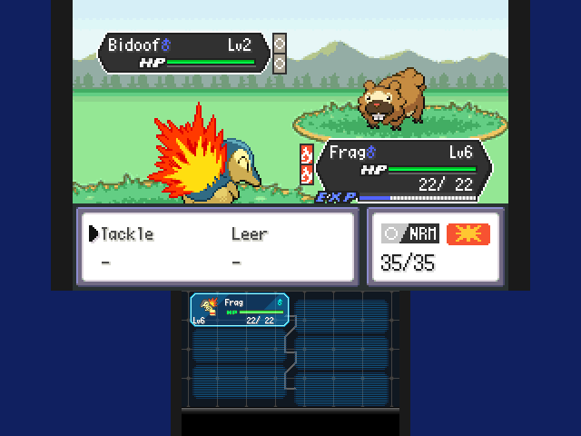
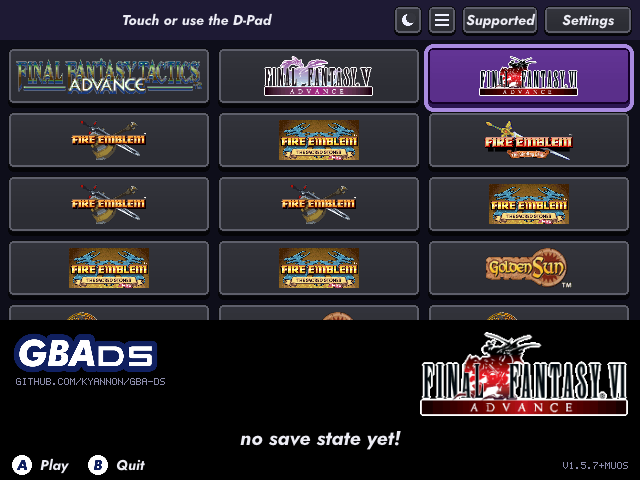
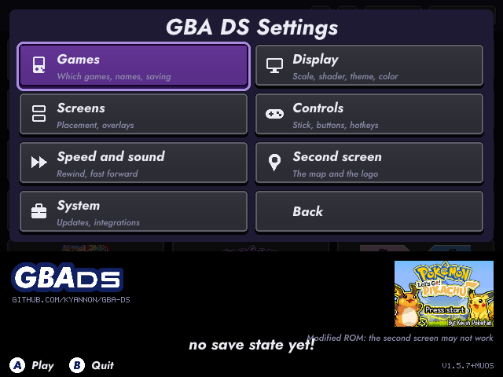
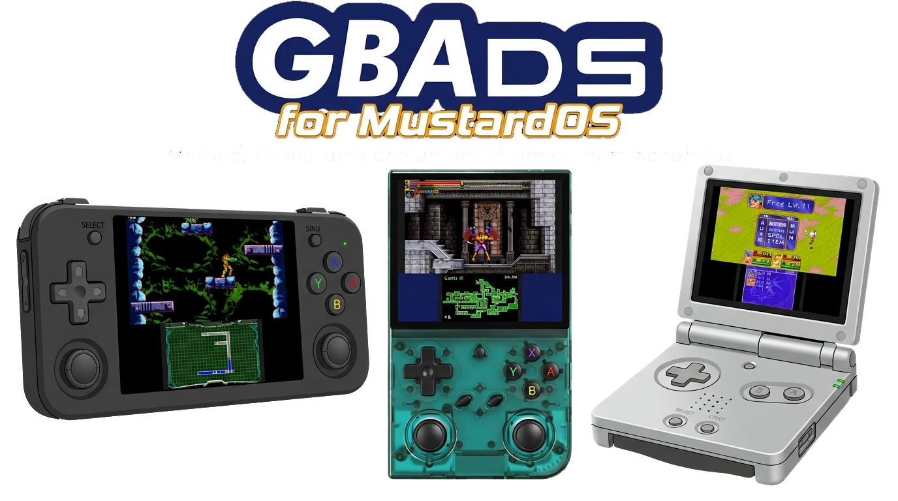

# GBA DS External Core for muOS

<p align="center">




</p>
<p align="center">



</p>

<sub>On a 640x480 muOS handheld: the game pixel perfect at 2x, and under it the game's own map, status screen or race HUD, or the rest of the pinball table.</sub>

**This is a fork of [GBA DS](https://github.com/kyannon/gba-ds) by kyannon, for [muOS](https://muos.dev) (MustardOS) handhelds.** It packages GBA DS for muOS 2612 Supernova and 2606 Andromeda as an app and as a Game Boy Advance core you can pick in muOS's Core Assignment, and adapts it to handhelds with one screen. Everything else, every supported game and its second screen, comes from upstream GBA DS; upstream's own README follows below this section.

**Download:** the latest `gba-ds-external-core-v…+muos.muxapp` from this fork's [Releases](https://github.com/fragilesilver/gba-ds-for-MustardOS/releases). **Install:** copy it to the card's `MUOS/ARCHIVE` folder, install it with muOS's Archive Manager, open Applications > GBA DS once, then choose **GBA DS - External Core** for your GBA folder in Core Assignment. The full guide: [Install on muOS](wiki/Install-on-muOS.md).

<p align="center">


</p>

### What this fork changes

- **muOS packaging:** a `.muxapp` with the GBA DS app, and **GBA DS - External Core** added to muOS's Game Boy Advance cores (Supernova's per-system definitions or Andromeda's `core.json`, put back if a muOS update removes it). Games started from muOS's lists close back to muOS.
- **muOS's folders and controls:** battery saves shared with RetroArch's mGBA core (`MUOS/save/file/mGBA`), screenshots in `MUOS/screenshot`, RetroArch's cheats and RetroAchievements account, the face buttons by position whichever controller layout muOS uses, MENU as the hotkey button, the device's rumble motor, and muOS's quit and sleep.
- **One screen, two pictures:** a *Game and second screen* layout splits the screen (the game at 2x with the map at 1x under it on 640x480), plus **hold or press to peek** at the second screen full-size.
- **Quality of life:** a first-start controls card, save slot hotkeys, *save while playing* (for a battery that runs out asleep) and battery save backups, a low battery warning, fast forward as hold or toggle (with a small corner badge), rumble and tilt for the cartridges that had them, and the map refreshing less often when the device can't keep full speed.
- **Built for the devices muOS runs on:** Cortex-A53 (plain ARMv8.0), no update checks (upstream's updates are the ROCKNIX package).

The details are in [CHANGELOG.md](CHANGELOG.md) (this fork's section is on top) and the settings in [Settings](wiki/Settings.md).

### Updates, issues and support

- **Updates are weekly**, or sooner for something urgent: upstream GBA DS releases are merged here (a weekly check opens an issue when there's a new one), then a new `v<version>-muos` release is built and published automatically.
- **Found a problem on muOS, or have an idea?** [Open an issue](https://github.com/fragilesilver/gba-ds-for-MustardOS/issues/new/choose) here. For second-screen support for a game, or a problem that also happens on ROCKNIX, Android or the web player, please use [upstream's issues](https://github.com/kyannon/gba-ds/issues).
- Building it yourself: `scripts/build-muos.sh` on an x86_64 Linux host (see "Building" below).

Like upstream, this fork is free software under the GNU GPL version 3, and it includes no games, BIOS files or other copyrighted game data.

---

# GBA DS

<p align="center"></p>

A Game Boy Advance emulator for dual-screen handhelds (built for the Anbernic RG DS Plus, on ROCKNIX and on Android with GammaOS). The game runs on one screen, and the game's own map stays up on the other screen and keeps itself current as you explore, the way the DS Castlevanias work.

The idea here is "what if the Game Boy Advance had a second screen" -- part of what this means is that, at least for now, neither screen is treated like a touchscreen. Instead the secondary screen is used similarly to how the DS Castlevania games use it -- displaying maps or other secondary information to make the gameplay experience a little more pleasant on a device with the space to accommodate it. (This whole project was inspired by playing through all the DS Castlevania games and then feeling a little sad about the prospect of going back in time to the GBA games...)

<p>


</p>

<sub>Stacked screens, pixel-perfect scaling, LCD grid on.</sub>

GBA DS supports 72 games, with their regional releases and some romhacks of them: see [Supported games](https://github.com/kyannon/gba-ds/wiki/Supported-games) in the wiki for the list and what each one shows on the second screen. Any other GBA game also runs; it just plays on one screen. Romhacks and other patches (`.ips`, `.ups`, `.bps`, `.xdelta`) can be switched on for each game in the pause menu (Extras → Patches).

**Documentation is in the [wiki](https://github.com/kyannon/gba-ds/wiki):** [Playing](https://github.com/kyannon/gba-ds/wiki/Playing) · [Supported games](https://github.com/kyannon/gba-ds/wiki/Supported-games) · [Overlays](https://github.com/kyannon/gba-ds/wiki/Overlays) · [Settings](https://github.com/kyannon/gba-ds/wiki/Settings) · [Troubleshooting](https://github.com/kyannon/gba-ds/wiki/Troubleshooting) · [Adding second-screen compatibility for a game](https://github.com/kyannon/gba-ds/wiki/Adding-second-screen-compatibility-for-a-game) · [Philosophy](https://github.com/kyannon/gba-ds/wiki/Philosophy)

## How it works

Emulation is [libmgba](https://mgba.io). GBA DS runs a second, silent copy of the emulator next to the real one. About every second (`map_interval` in `gba-ds.cfg`), and right after each room transition (detected as a fade to black), it does the following:

1. It copies the live game's state into the silent copy. The game you're playing is never paused or touched.
2. It presses the map button there, waits for the map screen to appear and settle, then records a short loop of frames so the blinking or pulsing player marker still animates.
3. It checks the result two ways before showing it: a memory flag that is set only while the map screen is open, and fixed pixels of the map screen's frame or background. Title screens, cutscenes, menus, and fades are rejected, and the previous map stays up.

You see the real in-game map with every detail the game draws (explored rooms, save and warp rooms, completion %, area names) at 4× integer scale. Circle of the Moon's map screen has no completion rate, so GBA DS copies the percentage shown after "RATE" on the game's pause screen onto the map, in the top-right corner, which stays clear of rooms even on a fully explored castle (the bottom-right corner is the fallback).

Games without a map use the second screen in other ways:

- **Mario Kart: Super Circuit** draws each frame twice: once without the HUD for the game screen, and once with only the HUD (coins, laps, time, the top four, the course map) for the second screen, so nothing behind the HUD is lost. The item box and your place are put back in the game screen's corners, and the course map is drawn twice as big over a dimmed picture of the course's scenery.
- **Tony Hawk's Pro Skater 2** copies the goal sheet for the current run to the second screen when the game shows it, and keeps it there while you skate.

Until there's something to show, the second screen shows the game's logo, extracted from the ROM in the background the first time a game appears in the list.

## Install

Download the latest release from the [Releases page](https://github.com/kyannon/gba-ds/releases), then follow the guide for your system:

- **[ROCKNIX](https://github.com/kyannon/gba-ds/wiki/Install-on-ROCKNIX)** (stock ROCKNIX or ROCKNIXDS): unzip `gba-ds-v…-linux-aarch64.zip` into `/storage/roms/ports/` and start **GBA DS** from Ports. The guide also covers the Ports icon, starting games from EmulationStation's Game Boy Advance list, and upgrading.
- **[BananaOS](https://github.com/kyannon/gba-ds/wiki/Install-on-BananaOS)**: the same zip, unzipped into the card's `roms/ports`; games in `roms/gba`.
- **[Stock Linux OS](https://github.com/kyannon/gba-ds/wiki/Install-on-Stock-Linux-OS)** (the RG DS Plus's own system, experimental): the same zip, unzipped into the card's `Ports` folder; games in `Roms/GBA`.
- **[muOS](wiki/Install-on-muOS.md)** (MustardOS 2606 Andromeda and 2612 Supernova, single-screen handhelds, experimental): **GBA DS External Core**. Copy `gba-ds-external-core-v…+muos.muxapp` to `MUOS/ARCHIVE`, install it with the Archive Manager, open Applications → GBA DS once, then assign **GBA DS - External Core** to your GBA folder in Core Assignment. The one screen is split: the game at pixel-perfect 2x (on 640x480) with the second screen under it.
- **[Android](https://github.com/kyannon/gba-ds/wiki/Install-on-Android)** (GammaOS): install `gba-ds-v…-android.apk`, allow All files access, and put your ROMs in `ROMs/gba`. To start games from GammaOS, Daijisho, ES-DE or another frontend, see [Launching from Android frontends](https://github.com/kyannon/gba-ds/wiki/Launching-from-Android-frontends).
- **[In your web browser](https://kyannon.github.io/gba-ds/)** (beta): choose a GBA game and play it with its second screen on a computer, a tablet or a phone, with nothing to install. Your games and saves stay on your device.

## Building

On an x86_64 Linux host with git, cmake, make, and zip, run:

```sh
scripts/build-rocknix.sh            # -> dist/gba-ds-v<VERSION>-linux-aarch64.zip
```

The script fetches a GCC aarch64 toolchain, mGBA (pinned commit), and SDL2 into `deps/`.

For muOS (GBA DS External Core, built for Cortex-A53 with no update checks):

```sh
scripts/build-muos.sh               # -> dist/gba-ds-external-core-v<VERSION>+muos.muxapp
```

Its scripts are in `dist/muos/`: `mux_launch.sh` (the app), `core.sh` (adds the core to muOS's Andromeda `core.json` or Supernova per-system definitions), `ext-gbads.sh` (muOS's launcher for the core) and `muos-play.sh` (muOS's folders and controls).

Dev builds (a `-dev` VERSION) also carry `gba-ds/web/gba-ds.wasm`, GBA DS compiled to WebAssembly by `scripts/build-web.sh` (needs clang, wasm-ld, llvm-ar, cmake and git, and the mGBA and SDL2 sources in `deps/` from `scripts/setup-host.sh` or `scripts/build-rocknix.sh`; it builds binaryen's `wasm-opt` the first time). Dropping such a zip on the GBA DS tab of the State Saver tool (`tools/statesaver/`) runs that build in a browser, both screens at default settings, for testing before it goes on a device.

To build for the host so you can develop and test (needs libpng-dev too):

```sh
scripts/setup-host.sh   # first time: mGBA and SDL2 into deps/, then builds
make && make tools      # afterwards: build/host/gba-ds, build/host/harness
```

The Android app, `scripts/build-android.sh` (-> `dist/gba-ds-v<VERSION>-android.apk`), needs the Android SDK and NDK, so it runs on GitHub Actions (`.github/workflows/android.yml`; the APK is in the run's artifacts). The web player, `scripts/build-web-player.sh` (-> `build/web-player/`), puts the web build in a page you can open in a browser; GitHub Pages publishes it from `main`.

Run it headless and drive it from a script (button combos, `HOME`, `TAP:x,y`, `SHOT:file.bmp`, `QUIT`; see `--help`):

```sh
SDL_VIDEODRIVER=offscreen SDL_AUDIODRIVER=dummy GBADS_WINDOW=640x960 \
  build/host/gba-ds --rom-dir=roms --state-dir=/tmp/st --input-script=test.txt
```

To add second-screen support for another game, see [Adding second-screen compatibility for a game](https://github.com/kyannon/gba-ds/wiki/Adding-second-screen-compatibility-for-a-game), and [Philosophy](https://github.com/kyannon/gba-ds/wiki/Philosophy) for what should go on the second screen.

## AI Disclosure

GBA DS is written almost entirely by AI. The code is written by Claude, Anthropic's AI model, working in Claude Code sessions, and so are the documentation, the changelog and the commit messages. I decide what gets built and how it should behave, and I test it.

**How a change gets made**

1. **I ask for something,** like a new game, a bug fix or a change to how something looks or feels. I usually include save states, screenshots or photos of the device showing what I mean.
2. **Claude writes the change** and checks it on a desktop build before I see it. GBA DS can run without a screen and play scripted button presses from a save state, so Claude takes screenshots of both screens and looks at them before sending me anything. For new games it also uses a test harness that steps the emulator frame by frame and reads the game's memory.
3. **I test every build on real hardware.** That's an Anbernic RG DS Plus, on ROCKNIX and on Android (GammaOS). Nothing goes into a release until I've played it on the device and confirmed it works and that what already worked still does. When something's wrong, I send photos or screenshots back and we go around again. Some changes take several rounds before they're right.
4. **Releases are my call.** I decide when a version is ready and create each GitHub release myself. The ROCKNIX zip is built from a fresh copy of the release code. The Android APK is built and signed by GitHub Actions, not on anyone's computer.

**What you can see in the history:** since October 16, 2026, each commit shows "kyannon authored and Claude committed", with a Verified badge. "Authored" means I asked for and approved the change; "committed" means Claude wrote it. Earlier commits show me alone, but they were made the same way.

**What isn't AI-generated:** the game logos and second-screen art are extracted from your own ROMs while the app runs, not drawn by AI or shipped with the app. Emulation itself is [mGBA](https://mgba.io)'s, a long-established, human-written emulator, which GBA DS builds on.

**What this means for you:** I can't promise there are no bugs, but every feature in a release has been used on the device it was made for. A feature that can't be tested on my hardware is labeled *experimental* (for example, starting games from some Android frontends). If something doesn't work for you, please [open an issue](https://github.com/kyannon/gba-ds/issues); it gets tested on hardware the same way.

## Not affiliated with Nintendo

GBA DS is an independent project. It is not affiliated with, endorsed by or sponsored by Nintendo, or by Anbernic, AYN, Retroid or any other device maker. Game Boy Advance, Nintendo DS and the names of the games are trademarks of their owners, used here only to say what GBA DS runs. The pictures show games running in GBA DS; the handhelds in them are generic drawings, not real products.

GBA DS includes no games, BIOS files or other copyrighted game data. Use your own legally obtained copies of your games.

## Licence

GBA DS is free software: you can redistribute it and/or modify it under the terms of the [GNU General Public License](LICENSE), version 3, as published by the Free Software Foundation. It is distributed in the hope that it will be useful, but WITHOUT ANY WARRANTY; without even the implied warranty of MERCHANTABILITY or FITNESS FOR A PARTICULAR PURPOSE. See the [GNU General Public License](LICENSE) for more details.

The parts of GBA DS made by others keep their own licences, all compatible with the GPL:

GBA DS statically links libmgba, which is © Jeffrey Pfau and licensed under MPL-2.0. The mGBA source is at <https://github.com/mgba-emu/mgba> (pinned commit in `scripts/mgba-options.sh`).

The interface text is set in [Jost](https://github.com/indestructible-type/Jost) (© The Jost Project Authors), bundled under the SIL Open Font License 1.1 (`assets/fonts/Jost-OFL.txt`), and drawn with [stb_truetype](https://github.com/nothings/stb) (public domain).

RetroAchievements support uses [rcheevos](https://github.com/RetroAchievements/rcheevos) (© RetroAchievements, MIT licence), vendored in `third_party/rcheevos`. WebP logos are read with [libwebp](https://github.com/webmproject/libwebp)'s decoder (© Google Inc., BSD licence), vendored in `third_party/libwebp`.
